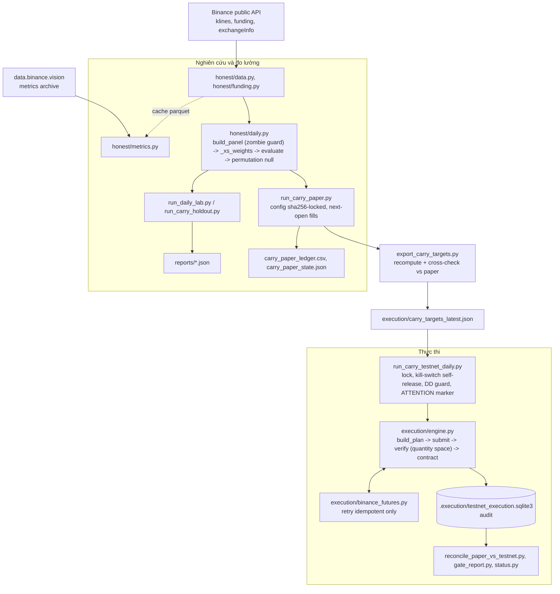

# Binance Analyst
[](.github/workflows/ci.yml) [](https://github.com/MinhNhat-2504/binance-analyst-hybrid-bot/actions/workflows/ci.yml) [](LICENSE) [](docker-compose.yml)

Bot funding carry cho Binance USDT-M perpetual, kèm harness đo edge chống leakage và engine đặt lệnh fail-closed.

## Demo

Không có giao diện. Đầu ra hằng ngày của bot là một dòng trạng thái và một file target. Ví dụ thật, in bởi `python status.py` ngày 25/09/2026:

```
CARRY-7d status  2026-09-25 07:46 UTC  (14:46 local)
  paper   day 52/60 (target 90)  equity 1.0814 (+8.14%)  sharpe +3.33  maxDD -2.9%  last booked 2026-09-23
  testnet COMPLETE 3/20 needed  last run 2026-09-05  missed (machine off?) 27
  markers none - next scheduled run will proceed
  canary  2026-09-20 (5d ago)  Binance +1.02 vs Bybit +1.43  funding +6.2%/yr  clear
  fills   90 legs  shortfall vs paper open: mean -5.2bps  p90 +62.6bps  (paper assumes ~10)
```

Ví dụ target mà engine nhận mỗi sáng (`execution/carry_targets_latest.json`, rút gọn):

```json
{
  "version": "CARRY_EXECUTION_TARGET_V1",
  "strategy": "CARRY-7d",
  "target_id": "58984bd557cba89ba34b82ff",
  "config_sha256": "25815e02...",
  "signal_time_utc": "2026-09-04T23:59:59.999Z",
  "weights": {"BTCUSDT": -0.0555555556, "PYTHUSDT": -0.0555555556, "SOLUSDT": 0.0625, "ATOMUSDT": 0.0625},
  "reference_prices": {"BTCUSDT": 79616.1, "PYTHUSDT": 0.05436, "SOLUSDT": 101.86, "ATOMUSDT": 1.493}
}
```

## Bài toán

Chiến lược crypto retail thường được chọn bằng backtest, và backtest thường sai vì leakage: nhãn tương lai lọt vào feature, purge theo số dòng thay vì theo thời gian, lọc mẫu bằng kết quả. Phiên bản đầu của repo này (bot scalping 15 phút, XGBoost + LSTM) có profit factor 2.2 đến 2.7 trong backtest và 0.999 khi chạy shadow 4.110 lệnh.

Câu hỏi thật không phải "chiến lược nào lãi" mà "làm sao biết một chiến lược có edge trước khi bỏ tiền". Repo trả lời bằng ba phần: một harness đo edge có permutation null và hold-out tách biệt, một chiến lược rule-based đơn giản đã qua harness đó (CARRY-7d), và một engine đặt lệnh không thể bật tiền thật bằng cờ runtime.

## Kiến trúc



Thành phần:

- `honest/`: đo lường. Tách riêng để mọi ý tưởng mới đi qua cùng một bộ kiểm (null, hold-out, halves, cost stress) và không dính vào code đặt lệnh.
- `clean_research/`: pipeline OOS độc lập thứ hai, ledger một dòng mỗi quyết định. Tách để có một kết luận không dùng chung code với `honest/`.
- `run_carry_paper.py`: executor paper. Tách vì config bị khóa hash và executor từ chối chạy nếu file config đổi; không có knob runtime.
- `export_carry_targets.py`: tầng kiểm soát giữa nghiên cứu và thực thi. Tính lại weight ngày mới nhất, đối chiếu với state paper, từ chối nếu lệch quá 1e-6.
- `run_carry_testnet_daily.py`: vòng lặp không người trực, thân chung cho testnet và live (`run_loop(LoopEnv)`); `run_carry_live_daily.py` chỉ thêm cổng ủy quyền. Tách khỏi engine để engine không biết gì về lịch, lock file hay marker.
- `execution/engine.py`: đặt lệnh và xác minh. Chỉ biết một target file và một policy; mọi bất thường đều kết thúc bằng một status có tên và một dòng audit.
- `execution/contracts.py`: trần vốn đóng băng bằng sha256 của file ceilings; live = 0.
- `gate_report.py`, `status.py`, `reconcile_paper_vs_testnet.py`: chỉ đọc, không đụng sàn.

Code chặn giữa hai tầng: nghiên cứu chỉ được ghi vào file target, engine đọc target và quyết định độc lập bằng code (drift gate, min-notional, kill-switch, verifier).

## Công nghệ sử dụng

| Tầng | Công nghệ | Vì sao chọn |
|---|---|---|
| Data | Binance REST public (`/fapi/v1/klines`, `/fundingRate`, `/exchangeInfo`) | Không cần key, không tốn phí, đủ cho khung ngày. Ràng buộc của dự án là mọi thứ phải miễn phí |
| Data | data.binance.vision metrics archive | REST chỉ giữ 30 ngày open interest và long/short ratio; archive giữ từ 2021-12, đã xác minh khớp REST 0.00% (`honest/metrics.py`) |
| Data | Bybit, OKX public API (`honest/crossex.py`) | Kiểm tra edge có phụ thuộc một sàn không; OKX chỉ có ~90 ngày funding nên bị loại khỏi gate |
| Data | pandas, numpy, pyarrow | Panel ngày x symbol; parquet để cache 75 symbol x 600 ngày không tải lại |
| Model | Rule cross-sectional (rank funding 7 ngày, long/short 20%) | Không train. Sau khi đo được tín hiệu ML 15m chỉ 4.9bps so với phí 12bps, chọn chiến lược mà phí không chi phối |
| Model | scikit-learn, XGBoost | Chỉ còn dùng trong `honest/evaluate.py` và `clean_research/model.py` để đo lại model cũ; không nằm trên đường chạy hằng ngày |
| Model | Permutation null tự viết (`honest/daily.py`, `honest/evaluate.py`) | Column-permutation giữ nguyên autocorrelation, turnover và cost profile, chỉ phá liên kết signal với symbol. Thư viện sẵn có không có null kiểu này |
| Serving | REST client tự viết (`requests` + HMAC) | Không dùng SDK để kiểm soát từng request: retry chỉ cho GET/DELETE, không bao giờ retry POST đặt lệnh, resync giờ khi gặp lỗi -1021 |
| Storage | SQLite (`.execution/*.sqlite3`) | Audit một file, không cần server, đọc được bằng `sqlite3` khi engine đã chết |
| Storage | JSON + sha256 (config, ceilings, target) | Khóa bằng hash để tune giữa chừng phải là một commit có review, không phải một lần sửa file |
| Infra | Windows Task Scheduler + `run_hidden.vbs` | Máy của tác giả là laptop Windows. Sự cố 31/08 (console bị đóng làm chết process) là lý do chạy ẩn qua vbs |
| Testing | pytest, 256 test | Fake exchange (`TrackingClient`) thay đổi inventory chỉ khi lệnh khớp thật, nên test được cả đường flatten và halt |

## Cách chạy

Yêu cầu: Python 3.11 (đã chạy trên 3.11.9). Mọi thứ chạy được trên Windows, Linux hoặc trong Docker; lịch tự động có hai cách, Windows Task Scheduler hoặc scheduler trong container.

```bash
git clone https://github.com/MinhNhat-2504/binance-analyst-hybrid-bot
cd binance-analyst-hybrid-bot
pip install -r requirements.txt
```

Nghiên cứu và paper không cần key:

```bash
python run_honest_harness.py --quick   # đo lại tín hiệu 15m cũ (kết luận: không có edge)
python run_daily_lab.py                # lab khung ngày, mỗi cell so với null riêng, ~10 phút lần đầu
python run_carry_holdout.py            # CARRY-7d trên 33 symbol hold-out
python run_carry_paper.py              # book paper ngày hôm nay; bỏ vài ngày nó tự bù
pytest                                 # 256 test, ~1 phút
```

Testnet cần key Binance Demo Trading. Tạo file `.env.testnet` (đã gitignore) với ba biến:

```
BINANCE_TESTNET_API_KEY=
BINANCE_TESTNET_API_SECRET=
BINANCE_TESTNET_HOST=demo
```

Loader chỉ đọc đúng ba tên này, cố ý bỏ qua `BINANCE_API_*` để key production trong shell không bị dùng nhầm. Kiểm tra key và chạy tay một ngày:

```bash
python run_testnet_execution.py --check-credentials
python export_carry_targets.py
python run_testnet_execution.py --plan                       # xem từng leg, không đặt lệnh
python run_testnet_execution.py --release-kill-switch "manual" --authorize-budget-usd 2000
python run_testnet_execution.py --execute --budget-usd 2000 --confirm-testnet I_ACCEPT_TESTNET_ORDERS
python reconcile_paper_vs_testnet.py
```

Mọi job đi qua một entry point: `python run_daily.py paper|testnet|canary|status`. Chạy tự động có hai cách, **chỉ dùng một trong hai** trên cùng một bộ state:

- Windows: bấm đúp `INSTALL_TASKS.bat` (ba task: paper 07:05, testnet 07:20, canary Chủ nhật 08:00, giờ Việt Nam, bật wake timer). Các file `.bat` chỉ gọi `run_daily.py`; đường dẫn Python trong đó là của máy tác giả.
- Docker, mọi hệ điều hành: `docker compose up -d`. Container chạy `run_scheduler.py` theo giờ UTC (00:05, 00:20, Chủ nhật 01:00), bind-mount thư mục repo làm state, healthcheck báo `unhealthy` khi có marker ATTENTION, lock kẹt hoặc paper im 3 ngày. `docker compose run --rm bot python run_daily.py status` để xem tình trạng.

Sau mỗi lần chạy testnet, `status.txt` được ghi ở gốc repo và chép ra Desktop nếu có.

Live: `run_live_execution.py` tồn tại nhưng trả về mã 2 "NOT AUTHORIZED" chừng nào `execution_ceilings_v1.json` còn ghi `live: 0.0`. Không có cờ nào bật được.

## Kết quả và đánh giá

Mọi số dưới đây có file gốc trong `reports/` hoặc ledger trong repo.

**CARRY-7d, backtest** (`reports/carry_holdout_report.json`, cửa sổ 600 ngày kết thúc 2026-07-31, phí 10bps mỗi chân, fill ở open ngày kế tiếp):

| | Discovery (42 symbol, 592 ngày) | Hold-out (33 symbol tách rời, 587 ngày) |
|---|---:|---:|
| Sharpe | 1.78 | 1.85 |
| Lợi nhuận/năm | +32.8% | +38.4% |
| Max drawdown | -14.7% | -12.5% |
| Sharpe khi phí 20bps | 1.20 | 1.31 |
| p-value, column-permutation null (200 lần) | 0.005 | 0.005 |
| Sharpe hai nửa | 1.77 / 1.80 | 2.57 / 1.43 |

**Cross-exchange** (`reports/crossex_lab_report.json`, 577 ngày chung): weight từ funding Binance áp lên giá Bybit giữ Sharpe 1.61 / 1.70; weight từ funding Bybit chỉ 1.09 / -0.35. Edge nằm ở thông tin trong funding Binance, không phải "funding nói chung".

**Pipeline OOS độc lập** (`CLEAN_OOS_FINDINGS.md`, `clean_research/`): CARRY-7d có PnL replay dương sau phí, nhưng CI 95% của các khối 120 ngày sau cutoff cắt 0. `reconcile_evaluators.py` cắt chuỗi của `honest/` đúng mốc đó và ra cùng số (+5.59 vs +4.97 bps/ngày, CI cắt 0 y hệt): hai bộ đo không mâu thuẫn, chỉ hỏi hai câu khác nhau. Với độ lệch chuẩn ngày ~96 bps, một khối 120 ngày chỉ có 18% xác suất tự chứng minh được kể cả khi edge là thật; toàn bộ 592 ngày cũng chỉ 65%. Bằng chứng thật cho CARRY-7d là t ≈ 2.3 trên ~590 ngày, lặp trên hai universe rời nhau. Chi tiết trong `HONEST_FINDINGS.md`.

**Paper trading** (`carry_paper_ledger.csv`, từ 2026-08-03): đến 18/10 có 77 ngày, +10,89%, Sharpe annualized 2,80, max drawdown −4,1%. Đối soát từng kỳ funding thật đủ 77/77 ngày cho lợi nhuận điều chỉnh +10,886% (`reports/paper_funding_audit.json`). Phân bổ theo đồng ở mốc 52 ngày (`analyze_paper_attribution.py`): chân long +22,6%, chân short −14,6%, funding chỉ +0,9%; đây là ảnh chụp lịch sử, không phải phân bổ của toàn kỳ 77 ngày.

**Testnet** (`reports/execution_fee_audit.json`): đến 20/10 có 13 phiên COMPLETE, đối chiếu đủ 338/338 lệnh và 406 giao dịch trên Binance Demo Futures. Hoa hồng 4,16 bps theo notional, tỷ trọng maker 0%; shortfall có dấu so với open paper +9,17 bps theo notional, tổng chi phí +13,32 bps so với giả định paper 10 bps/chân. `execution_quality.csv` đã được dựng lại đủ 338 lệnh; cổng khóa dùng mean theo lệnh +8,99 bps và vẫn PASS. Phép đo demo chưa dự báo chi phí live. Xem `EXECUTION_COST_EXPERIMENT.md` để thử maker trên tài khoản riêng.

**Q4 research** (`HONEST_FINDINGS.md`): LOWVOL-XS đã dừng ở discovery. SMART-VS-CROWD đã tải đủ archive discovery, đối chiếu archive/REST qua, rồi dừng theo cổng Sharpe gộp <0,5 đã đăng ký (D7 −0,63; D30 +0,26). Không mở hold-out của hai cell này.

**Bot 15m cũ** (`reports/honest_harness_CLEAN.json`, 131 feature, 540 ngày, 8 fold, 20 permutation): SHORT hơn null +4.94bps, p=0.19; LONG +0.85bps, p=0.476; phí khả thi thấp nhất 12bps. Đã đóng.

**Tách theo chân** (`analyze_backtest_legs.py`, 600 ngày, cùng phí): chân short là toàn bộ edge (+40%/năm discovery, +54% hold-out, Sharpe riêng 1.0 và 1.4, dương cả hai nửa; giá +44 đến +57%, funding chỉ +2.5 đến +2.9%), chân long lỗ (−7% và −15%/năm) và chỉ đóng vai hedge beta. Từ 03/04/2026 chân short trên discovery lỗ −39%/năm trong khi chân long lãi +59%: tháng 9 paper lãi nhờ chân yếu.

**Các hướng đã đo và đóng** (`HONEST_FINDINGS.md`): rebalance 8h (Sharpe 0.84 so với 1.85), basis carry spot-perp (funding không vượt phí 4 chân), vol-targeting overlay (ngày tệ nhất luôn tệ hơn).

Cổng bật live được ghi trước trong `carry_paper_config_v1.json` và chấm bằng `gate_report.py` (13 điều kiện). Kết quả ngày 20/10: NOT-YET, còn thiếu 7 phiên testnet COMPLETE; mốc sớm nhất 27/10 nếu mỗi ngày đều COMPLETE. Chi phí all-in 13,32 bps là cảnh báo kinh tế bổ sung và chưa thuộc thước đo shortfall đã khóa của cổng.

## Các quyết định thiết kế chính

- **Quyết định**: khóa config paper bằng sha256, executor từ chối chạy nếu file đổi, thay vì cho phép chỉnh tham số.
  **Vì**: tune giữa chừng là chính cơ chế đã tạo ra profit factor 2.69 giả ở bản đầu. Một record 60 ngày của luật bị sửa dọc đường không chứng minh gì.
  **Đánh đổi**: phát hiện lỗi thật trong config cũng phải chờ hết kỳ paper hoặc chấp nhận reset đồng hồ.

- **Quyết định**: engine chỉ tự thanh lý khi vị thế sai so với contract; mọi bất thường khác (mất mạng, lệnh chờ lạ, không ghi được audit) dừng lại và giữ nguyên rổ.
  **Vì**: "không biết" khác "sai". Sự cố 05/09 chứng minh ngược lại: một lỗi SSL thoáng qua đã thanh lý cả rổ đúng.
  **Đánh đổi**: nhiều trạng thái kết thúc cần người đọc runbook (13 status), và một rổ lệch có thể nằm qua đêm chờ người xử lý.

- **Quyết định**: verifier so vị thế trong không gian quantity (số coin, làm tròn theo stepSize) thay vì notional.
  **Vì**: notional đổi theo giá mark từng giây; quantity là thứ sàn thật sự giữ. Tolerance tính từ stepSize và minNotional của từng symbol.
  **Đánh đổi**: phải tải và cache exchangeInfo, và phải xử lý riêng va chạm giữa trần một lệnh và minNotional (sự cố 04/09).

- **Quyết định**: giới hạn nghiên cứu 3 họ chiến lược mỗi quý, đăng ký trước grid, null và luật quyết định (`RESEARCH_PREREG_Q4_2026.md`).
  **Vì**: mỗi cell thêm vào làm mòn ý nghĩa thống kê của toàn bộ; quét đủ nhiều rồi giữ cell đẹp nhất là cách tạo kết quả giả.
  **Đánh đổi**: có ý tưởng hay giữa quý cũng phải chờ; kết quả âm chiếm slot như kết quả dương.

- **Quyết định**: live bị khóa ở hai tầng (file ceilings `live: 0.0` được hash vào contract, và hằng số `ABSOLUTE_GROSS_UPPER_BOUND_USD = 5000` trong code) thay vì một biến môi trường.
  **Vì**: bật tiền thật phải là một commit có review, làm đỏ một test viết riêng để báo, không phải một lần export biến.
  **Đánh đổi**: chuyển sang live cần sửa test và file ceilings, mất khoảng một buổi.

## Hạn chế và việc làm tiếp

Hạn chế đọc từ code:

1. Bằng chứng cho CARRY-7d là t ≈ 2.3 trên ~590 ngày, không phải áp đảo, và kỳ paper 60 hoặc 90 ngày về mặt thống kê không thể tự chứng minh edge (nửa CI ~24 bps ở 60 ngày). Paper chỉ kiểm được tracking, không kiểm được edge.
2. Lãi paper tập trung: phân bổ ở mốc 52 ngày cho thấy một ngày chiếm 33,5% tổng, ba đồng long chiếm 45% lãi gộp, 21/39 đồng âm. Chân long lịch sử lỗ 7 đến 15%/năm và chỉ là hedge; quy tắc thăm dò short-only + BTC hedge đã chạy trên hai tập từng được xem, thua v1 ở cả hai (`reports/short_btc_hedge_exploratory.json`). Không thay v1 dựa trên mẫu này.
3. Bằng chứng thực thi còn mỏng: 13 ngày testnet COMPLETE, 338 lệnh; chi phí hoa hồng cộng shortfall +13,32 bps theo notional vượt giả định paper 10 bps/chân. Tỷ trọng maker 0%, nên cần thử nghiệm tách biệt trên tài khoản Demo Futures riêng. Tháng 9 mất 20 ngày testnet vì marker ATTENTION nằm trong thư mục ẩn không ai nhìn, rồi thêm 5 ngày vì một lần drift gate từ chối (không đặt lệnh nào) cũng ghi marker chặn. Từ 03/10 chỉ trạng thái có thể có vị thế lệch mới chặn; từ chối trước khi đặt lệnh chỉ ghi NOTICE.
4. Canary signal-health ba tuần liền nghiêng về Bybit (Sharpe theo weight Binance trên 180 ngày giảm 1.60 xuống 1.02). Chưa có luật tự động nào dừng paper khi canary xấu đi; quyết định vẫn thủ công.
5. Đã chạy được trong Docker và có scheduler riêng, nhưng mới chỉ thử trên máy tác giả; chưa từng chạy một ngày thật trên server Linux. Toast Windows trong `notify_markers.py` là best-effort, trên Linux chỉ còn file `status.txt` và healthcheck.
6. Vòng live không người trực (`run_carry_live_daily.py`) đã viết và test bằng sàn giả, nhưng chưa từng chạy một ngày thật; tháng đầu live vẫn là chạy tay theo checklist, và file ủy quyền `unattended_live_v1.json` chỉ được viết sau đó.
7. Order style `MAKER_THEN_MARKET` đã viết và test nhưng chưa từng chạy trên sàn; mặc định vẫn MARKET. Tổng thời gian chờ maker bị chặn ở nửa TTL kill-switch, chưa đo trên fill thật.
8. Universe 42 symbol cố định từ tháng 8; MKRUSDT và TONUSDT đã SETTLING trên live, được zombie guard loại nhưng chưa có cơ chế thay symbol.
9. Sáu symbol trả funding mỗi 4h (TIA, ENA, JTO, PYTH, TAO, ORDI) chiếm 17,9% số chỗ trong rổ paper ở mốc 52 ngày và gần như chỉ ở bên short. Đối soát theo kỳ settle thật đã hoàn tất cho toàn bộ 77 ngày paper đến 18/10; sai khác do cách gán kỳ là −0,70 bps cộng dồn (`reports/paper_funding_audit.json`).

Việc làm tiếp, theo thứ tự:

1. Đủ 20 ngày testnet COMPLETE; hiện 13/20, mốc sớm nhất 27/10 nếu mỗi ngày đều COMPLETE.
2. Tiếp tục đo chi phí và tracking trên các phiên COMPLETE mới. Sau khi cấu hình API key riêng, chạy preflight và pilot maker theo `EXECUTION_COST_EXPERIMENT.md` trên tài khoản Demo Futures tách biệt. Không dùng tài khoản bot hằng ngày.
3. Giữ ba cell Q4 đã dừng ở discovery theo luật đăng ký; giữ hold-out chưa mở. Kết quả short + BTC chỉ là thăm dò lịch sử âm so với v1, nên chưa có ứng viên thay thế. Xem `RESEARCH_PREREG_Q4_2026.md` và `HONEST_FINDINGS.md`.

## Cấu trúc thư mục

```
honest/                     harness đo edge: data, features, labels, cv, evaluate, execution sim, funding, daily lab, basis, crossex, metrics
clean_research/             pipeline OOS độc lập: schema, ledger, model, carry, intraday_carry
execution/                  engine đặt lệnh, REST client, contracts (ceilings sha256), targets
tests/                      256 test; TrackingClient là fake exchange
reports/                    JSON kết quả của mọi lab; bằng chứng cho HONEST_FINDINGS.md
archive/legacy_15m/         bot 15m cũ, giữ nguyên để đối chiếu; không tin số trong đó
run_daily_lab.py            grid khung ngày đăng ký trước (UNIVERSE 42)
run_carry_holdout.py        CARRY-7d trên HOLDOUT_UNIVERSE 33
run_lowvol_xs_lab.py        cell LOWVOL-XS Q4 đã đăng ký; discovery trước, hold-out có cổng
run_smart_vs_crowd_lab.py    cell SMART-VS-CROWD Q4; discovery đã dừng, hold-out có cổng
audit_smart_source.py        đối chiếu metrics archive[D] với REST[D+1] (chỉ đọc)
run_carry_paper.py          executor paper, config khóa hash
export_carry_targets.py     nghiên cứu -> target file, có cross-check
run_carry_testnet_daily.py  vòng lặp không người trực (lock, self-release, DD guard, marker)
run_testnet_execution.py    CLI testnet thủ công (--plan, --execute)
run_live_execution.py       CLI live thủ công, trơ khi ceilings live = 0
run_carry_live_daily.py     vòng live không người trực; cần ceilings v2 + unattended_live_v1.json + sha khớp
gate_report.py              chấm 13 điều kiện cổng ngày 60/90
status.py                   6 dòng tình trạng; ghi ra Desktop mỗi sáng
check_live_filters.py       sàn thật nhận rổ ở vốn tối thiểu bao nhiêu (không cần key)
collect_daily_snapshots.py  gom OI, long/short ratio, taker flow mỗi ngày (data_snapshots/, không commit)
run_canaries.py             signal-health và funding-regime hằng tuần
backup_state.py             backup ledger/audit/state mỗi sáng vào backups/ (giữ 30 ngày)
export_income.py            income của sàn theo tháng -> reports/income_<env>_<YYYY-MM>.csv
analyze_paper_attribution.py  PnL paper theo từng đồng, mức tập trung; tự kiểm khớp ledger
audit_paper_funding.py      đối soát funding paper theo từng kỳ settlement (chỉ đọc)
audit_execution_fees.py     đối chiếu phí và shortfall trên orderId COMPLETE (chỉ đọc)
audit_execution_opportunity.py  đối soát phí maker và trần tiết kiệm chỉ từ phí (chỉ đọc)
probe_maker_account.py      preflight chỉ đọc tài khoản Demo Futures thử maker riêng
explore_short_btc_hedge.py  thăm dò quy tắc short + BTC, không tạo targets
analyze_backtest_legs.py    backtest 600 ngày tách chân long / chân short, theo nửa và theo cutoff
run_daily.py                entry point mọi job: paper | testnet | canary | status
run_scheduler.py            scheduler UTC cho container hoặc Linux không cron
healthcheck.py              Docker HEALTHCHECK: marker, lock kẹt, paper im
Dockerfile, docker-compose.yml  image python:3.11-slim, state bind-mount, chạy non-root
notify_markers.py           có marker -> file trên Desktop
carry_paper_config_v1.json  luật CARRY-7d và cổng, sha256-locked
execution_ceilings_v1.json  trần vốn: testnet 2000, live 0
HONEST_FINDINGS.md          vì sao bot 15m không có edge, và mọi hướng đã đóng
EXECUTION_RUNBOOK.md        bảng status và việc phải làm
GO_LIVE_CHECKLIST.md        khung vốn, cổng, tiêu chí dừng, lịch
RESEARCH_PREREG_Q4_2026.md  ba cell tháng 10, khóa trước khi chạy
```

## Đối soát funding của kỳ paper

`python audit_paper_funding.py` đọc ledger và cache funding, rồi ghi
`reports/paper_funding_audit.json`. Script so sánh quy tắc chia 1/3–2/3 của
paper với từng mốc settlement thật; kết quả `partial` có mã thoát 2 và chỉ
phản ánh những ngày đủ dữ liệu. `python audit_paper_funding.py --refresh` lấy
lịch sử funding công khai mới từ Binance trước khi đối soát toàn kỳ. Việc này
không sửa luật giao dịch, ledger hay trạng thái paper đang khóa.

## Ghi nhận và giấy phép

- Dữ liệu: Binance USDT-M Futures public REST và data.binance.vision; Bybit v5 và OKX public API cho kiểm tra cross-exchange. Không dùng dữ liệu trả phí.
- Không có model gốc bên ngoài; model 15m cũ tự train và đã archive.
- Thư viện: pandas, numpy, pyarrow, requests, scikit-learn, XGBoost, joblib, pytest.
- Giấy phép: MIT, xem file `LICENSE`.

Repo phục vụ nghiên cứu. Funding carry vẫn lỗ nặng được khi thị trường squeeze; ai bật live tự chịu trách nhiệm.

Trịnh Ngọc Minh Nhật
